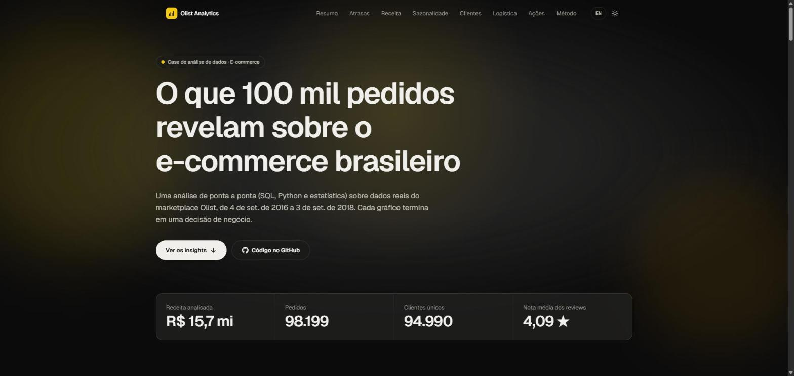
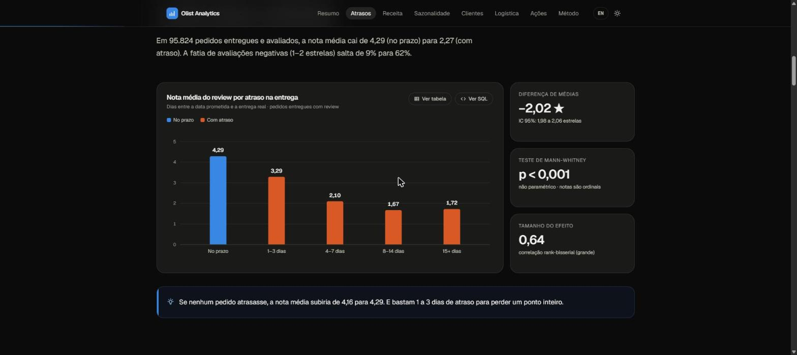
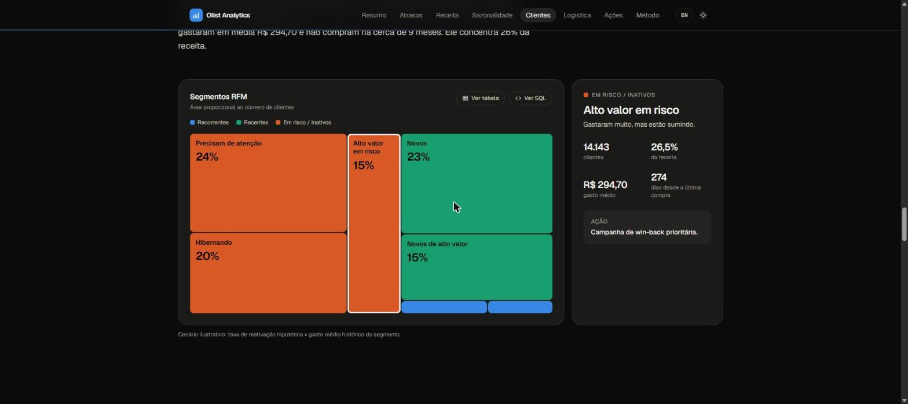

# E-commerce Sales Analytics

**O que 100 mil pedidos revelam sobre o e-commerce brasileiro.** Análise de ponta a ponta (ETL → PostgreSQL → SQL analítico → Python/estatística → site interativo) sobre dados reais do marketplace Olist, com cada achado convertido em recomendação de negócio.

**[Ver o site ao vivo](https://vendas-br.vercel.app/pt/)** · [English version](https://vendas-br.vercel.app/en/) · [Notebook de exploração](notebooks/01_exploracao.ipynb)



## Principais achados

| # | Pergunta de negócio | Resposta (dados reais) | Recomendação |
|---|---|---|---|
| 1 | O atraso na entrega afeta a nota do review? | Sim, e muito: nota média **4,29 no prazo vs. 2,27 com atraso** (−2,02 estrelas, IC 95%: 1,98–2,06; Mann-Whitney p < 0,001). Avaliações negativas sobem de 9% para 62%. | Prometer prazos realistas. Zerar atrasos elevaria a nota média de 4,16 para 4,29. |
| 2 | Quais estados e categorias geram mais receita? | SP, RJ e MG somam **63%** da receita (SP sozinho, 37%). As 10 maiores de 74 categorias respondem por 62%. | Relógios & presentes tem o maior ticket do top 10 (R$ 231,67): foco em campanhas sazonais. |
| 3 | Como é a sazonalidade? | Crescimento contínuo em 2017 e platô em 2018. Na **Black Friday (24/11/2017) o volume foi 7,2× a média diária**. Picos em dias úteis, das 10h às 22h. | Playbook de capacidade para novembro e mídia concentrada em dias úteis. |
| 4 | Quais grupos de clientes (RFM) merecem retenção? | **Só 3% dos clientes compram de novo.** O segmento "alto valor em risco" tem 14 mil clientes e 26% da receita. | Win-back: reativar 10% desse grupo ≈ R$ 417 mil. |
| 5 | Tempo de entrega por estado afeta a satisfação? | A nota acompanha a **taxa de atraso (r = −0,88)** muito mais que o **tempo de entrega (r = −0,45)**. AM e AP têm as entregas mais lentas e notas altas porque quase não atrasam. | Parceiros logísticos regionais onde o atraso passa de 15% (AL, MA, SE). |

<p>
  
  
</p>

## O que este projeto demonstra

- **SQL analítico de verdade:** CTEs, window functions (`ROW_NUMBER`, `LAG`, `RANK`, médias móveis, somas acumuladas para Pareto) e `PERCENTILE_CONT`. Uma query por pergunta em [`sql/analysis/`](sql/analysis/). Cada gráfico do site tem um botão **"Ver SQL"** que mostra a query que o gerou.
- **Modelagem relacional:** 9 tabelas com PK/FK, tipos corretos e índices ([`sql/schema.sql`](sql/schema.sql)), carregadas via `COPY` (1,55 milhão de linhas em segundos).
- **Rigor estatístico:** teste de Mann-Whitney (notas são ordinais, então não cabe teste t), intervalo de confiança, tamanho de efeito e correlações ([`src/stats.py`](src/stats.py)).
- **Segmentação RFM adaptada aos dados:** com 97% de compradores únicos, quintis de frequência não fazem sentido. A frequência virou regra explícita, e isso foi documentado ([`src/rfm.py`](src/rfm.py)).
- **Qualidade de dados:** checagens automatizadas de pedidos sem itens, reviews duplicados, categorias sem tradução etc., cada uma com o tratamento aplicado ([`src/quality.py`](src/quality.py)).
- **Engenharia:** pipeline reproduzível em um comando, testes com pytest, lint com ruff e CI no GitHub Actions.
- **Comunicação:** site bilíngue (PT/EN), responsivo, com tema claro/escuro, gráficos acessíveis (paleta validada para daltonismo, visão em tabela, navegação por teclado) e Lighthouse 100 no desktop.

## Arquitetura

```
Kaggle API ──► src/download.py ──► data/raw/*.csv
                                        │
                                        ▼
              src/load.py (pandas + COPY) ──► PostgreSQL 16 (Docker)
                                                   │
                     sql/analysis/*.sql ◄──────────┤
                     src/stats.py, src/rfm.py ◄────┤
                     src/quality.py ◄──────────────┘
                                        │
                                        ▼
              src/export.py ──► web/src/data/*.json (versionados)
                                        │
                                        ▼
              web/ (Next.js, export estático) ──► Vercel
```

O site consome JSONs pré-agregados: não há banco em produção, o deploy é gratuito e a página carrega instantaneamente.

## Stack

| Camada | Tecnologias |
|---|---|
| Dados | PostgreSQL 16 (Docker), SQL |
| Pipeline e análise | Python, pandas, SQLAlchemy, SciPy, Jupyter |
| Qualidade | pytest, ruff, GitHub Actions |
| Site | Next.js 16 (export estático), TypeScript, Tailwind CSS, D3 (escalas/formas), Motion, Lenis, Shiki |

## Como rodar localmente

Pré-requisitos: Docker, Python 3.11+, Node 20+ e um token da [Kaggle API](https://www.kaggle.com/settings) salvo em `~/.kaggle/kaggle.json`.

```bash
# 1. Banco
cp .env.example .env
docker compose up -d            # PostgreSQL na porta 5433

# 2. Pipeline completo: download, carga, análises e export dos JSONs do site
python -m venv venv
venv\Scripts\activate           # Linux/macOS: source venv/bin/activate
pip install -r requirements.txt
python -m src.pipeline

# 3. Testes
pytest

# 4. Site
cd web
npm install
npm run dev                     # http://localhost:3000/pt/
```

`python -m src.pipeline --skip-load` reexporta os dados sem recarregar o banco.

## Estrutura

```
├── sql/
│   ├── schema.sql              # modelo relacional
│   ├── analysis/               # uma query por pergunta de negócio
│   └── support/                # queries auxiliares (teste estatístico)
├── src/
│   ├── pipeline.py             # orquestra todas as etapas
│   ├── download.py · load.py   # ingestão
│   ├── quality.py              # checagens de qualidade
│   ├── stats.py · rfm.py       # estatística e segmentação
│   └── export.py               # gera os JSONs do site
├── tests/                      # pytest
├── notebooks/01_exploracao.ipynb
└── web/                        # site Next.js
```

## Limitações e próximos passos

- Dados de 2016–2018 de um único marketplace; a cobertura é parcial nas pontas da série (por isso o recorte de jan/2017 a ago/2018 na sazonalidade).
- Os cenários de impacto (ex.: reativação de 10%) são ilustrativos, baseados no gasto histórico, e não previsões.
- Próximos passos: previsão de demanda para a Black Friday, análise de texto dos comentários negativos e teste A/B para validar o efeito de prazos mais conservadores.

## Fonte de dados

[Olist Brazilian E-Commerce Public Dataset](https://www.kaggle.com/datasets/olistbr/brazilian-ecommerce) (Kaggle, CC BY-NC-SA 4.0): cerca de 100 mil pedidos reais e anonimizados.

---

Feito por **Alexandre Lopes**.
